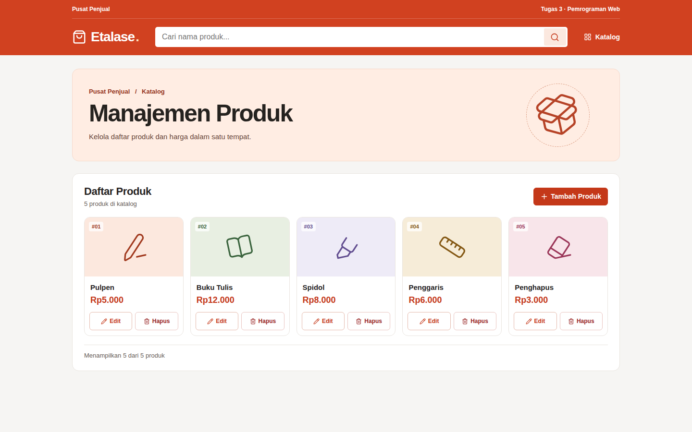

## Ringkasan Perubahan

Menambahkan katalog React responsif dengan pencarian berdasarkan nama, harga dalam rupiah, serta dialog tambah, edit, dan konfirmasi hapus. Perubahan disimpan di browser menggunakan `localStorage`.

## Bukti Pengujian

Build Vite dan tiga pengujian penyimpanan lulus. Skenario berikut dijalankan di Chrome.

| Skenario | Hasil yang Diharapkan | Hasil Aktual |
|---|---|---|
| Buka katalog di desktop dan layar 390 piksel | Lima produk contoh tampil tanpa gulir horizontal | Lima produk tampil di kedua ukuran |
| Cari `SPIDOL` dengan spasi di awal dan akhir | Hanya Spidol yang tampil | Filter menampilkan satu produk |
| Simpan produk dengan harga nol, lalu ganti ke Rp18.000 | Harga nol ditolak. Produk dengan harga valid tetap tampil setelah muat ulang | Keduanya sesuai |
| Edit nama dan harga menjadi Rp19.500 | Nilai baru tetap tampil setelah muat ulang | Nama dan harga baru tersimpan |
| Batalkan hapus, lalu konfirmasi hapus | Batal mempertahankan produk. Konfirmasi menghapus produk setelah muat ulang | Keduanya sesuai |
| Simulasikan penyimpanan browser gagal | Dialog tetap terbuka, pesan kesalahan tampil, daftar tetap sama | Ketiganya sesuai |
| Pantau permintaan saat membuka katalog dan melakukan CRUD | Alur berjalan tanpa permintaan API | Tidak ada permintaan ke `/api/` |

[Katalog mobile](katalog-mobile.png) · [Dialog tambah](dialog-tambah.png) · [Dialog edit](dialog-edit.png) · [Dialog hapus](dialog-hapus.png)
