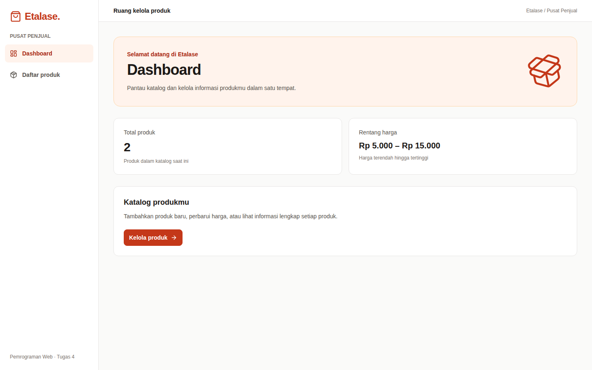
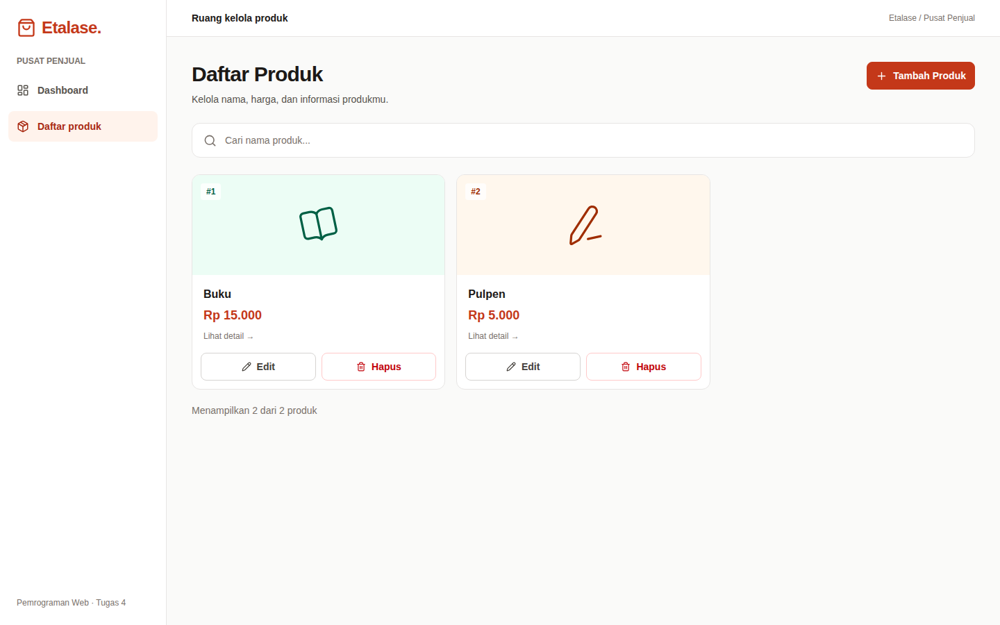
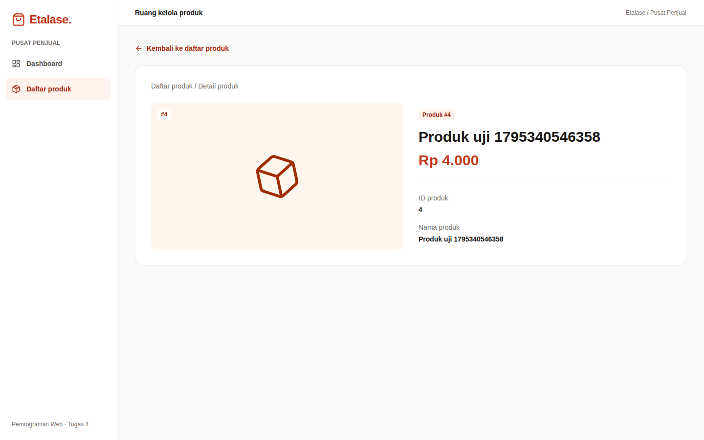
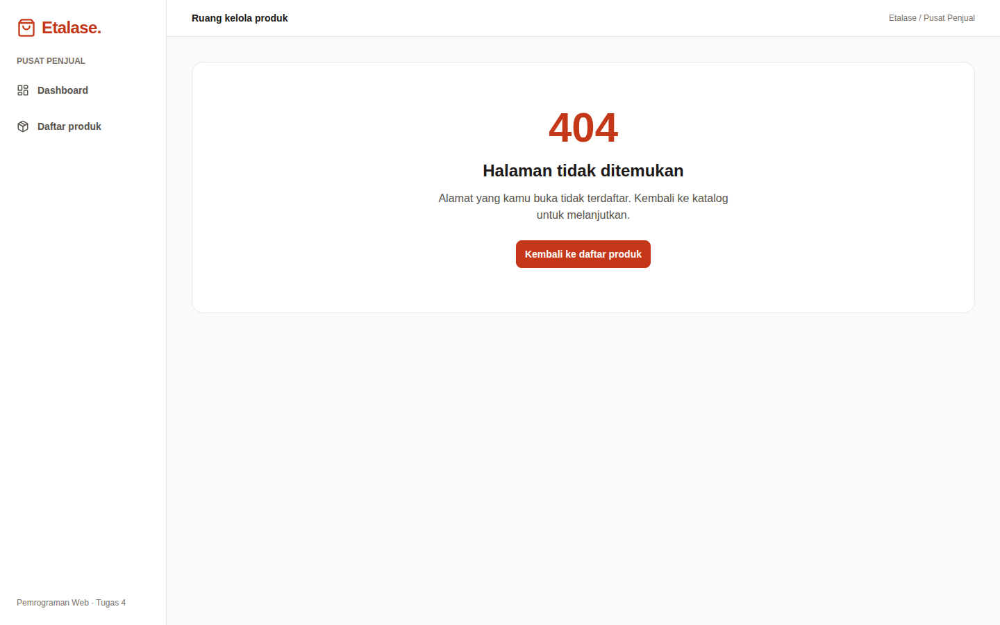

# Bukti Pengujian Tugas 4

Pengujian dilakukan pada 22 November 2026 dengan Chrome, frontend Vite, service Express tugas sebelumnya, dan PostgreSQL lokal. Data yang ditampilkan mengikuti isi database saat pengujian.

| Skenario | Hasil yang diharapkan | Hasil aktual |
|---|---|---|
| Buka `/`, lalu navigasi memakai sidebar | Index route membuka dashboard. Sidebar bertahan dan dokumen tidak dimuat ulang | Sesuai, penanda pada window tetap tersedia setelah navigasi |
| Tambah produk | POST berhasil, detail produk baru terbuka, data tetap tersedia setelah reload | HTTP 201, nama dan harga tampil setelah reload |
| Klik produk dari katalog | Detail mengikuti ID pada URL | Nama detail cocok dengan produk yang dipilih |
| Cari nama dengan huruf kapital dan spasi | Produk cocok tetap ditemukan | Satu produk uji ditemukan |
| Edit nama dan harga | PUT menyimpan perubahan, GET berikutnya mengembalikan nilai baru | Nama revisi dan harga Rp4.500 dikonfirmasi melalui API dan reload |
| Batal hapus menggunakan Escape, lalu konfirmasi hapus | Batal mempertahankan produk. Konfirmasi menghapusnya | Produk tetap ada setelah Escape, DELETE berhasil, GET berikutnya HTTP 404 |
| Buka detail produk yang dihapus | Pesan produk tidak ditemukan dan tautan kembali | Sesuai |
| Buka URL tidak terdaftar | Halaman 404 dan tautan ke katalog | Sesuai |
| Isi nama dengan spasi atau harga nol | Form menolak penyimpanan | Validasi nama dan harga tampil sebelum POST |
| API daftar gagal sekali | Pesan kesalahan dan Coba lagi bekerja | Daftar berhasil dimuat setelah retry |
| POST gagal | Dialog tetap terbuka dan isian tetap tersedia | Pesan server tampil, isian dan tombol simpan tetap tersedia |
| Layar 390 piksel | Navigasi dan katalog dapat digunakan tanpa gulir horizontal | Lebar dokumen tetap 390 piksel |

`npm test` lulus 2/2. `npm run build` berhasil. `npm run test:e2e` lulus 2/2. Tes browser mencakup alur CRUD nyata dan simulasi kegagalan API. Produk uji dihapus pada akhir pengujian.

[Layar mobile](mobile.png) · [Produk tidak ditemukan](missing-product.png) · [Dialog tambah](add-dialog.png)
